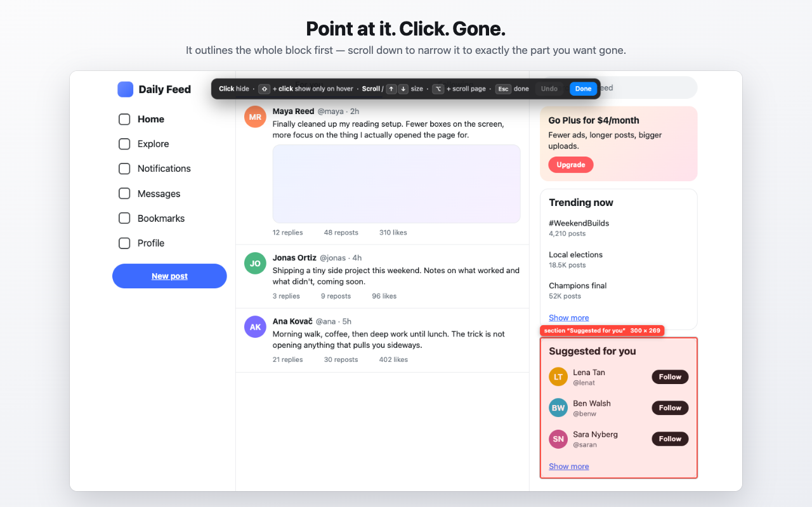

# Hide It

A Chrome extension to point at any part of a website and hide it for good: sidebars, suggestion boxes, promos, trending lists, sticky banners. Hidden parts stay hidden on every later visit, and they don't flicker in first.



## Features

- **Point, click, gone.** The outline starts on the whole block under the pointer. Scroll down (or press ↓) to narrow it, and scroll up (or press ↑) to widen it. Click to hide.
- **No flicker.** Rules are CSS (`display: none !important`) added before the page paints. This also works on apps that build their page long after it loads.
- **Peek.** Hold ⌥ / Alt on a page to see everything you hid, outlined, until you let go.
- **Show on hover.** ⇧-click keeps an element invisible but in its place; point at that spot and it fades in.
- **Loose text.** Text written straight into a container next to other blocks, like an SEO paragraph under a grid, can be hidden on its own.
- **The list.** The popup lists what's hidden on the current site:
  - point at a row to see that element again;
  - ✕ brings it back for good;
  - the switch pauses the site.
- **Between profiles.** *Copy all rules* in one Chrome profile, then *Paste rules* in another.
- **Undo.** Press ⌘Z / Ctrl+Z while picking.

Start the picker from the toolbar icon, with **⌥⇧H** / **Alt+Shift+H**, or by right-clicking and choosing **Hide an element on this page…**.

## Install from source

1. Download or clone this repository.
2. Open `chrome://extensions` and turn on **Developer mode**.
3. Click **Load unpacked** and choose the repository folder.

## Privacy

Hide It has no servers, no accounts and no analytics. It never reads or sends the content of the pages you visit. Your rules are saved only in your browser's local extension storage (`chrome.storage.local`).

## How it works

| File | Role |
| --- | --- |
| `content.js` | Runs at `document_start` on every page. It adds one `<style>` with the site's rules and contains the element picker. |
| `gate.js` | Registered only for sites that have rules. It keeps the page transparent for the few milliseconds before the saved rules load, so a fast page can't paint a hidden element first. |
| `background.js` | Keyboard shortcut, context menu, toolbar badge, and the `gate.js` registration. |
| `popup.*` | The list of hidden elements, plus copy / paste between profiles. |

## Development

```sh
npm install
npx playwright install chromium   # once: the browser the tests drive
npm test            # end-to-end tests in Playwright's Chromium (headless, own profile)
npm run assets      # re-render the Chrome Web Store images in store/assets
npm run icons       # re-draw icons/ (macOS, Swift)
npm run package     # dist/hide-it-<version>.zip for the Chrome Web Store
```

The tests use mock pages in `test/site/` and check, among other things:

- that hidden elements never appear in a single frame across repeated reloads;
- the picker's levels and the wheel steps;
- copy / paste between two separate profiles.

## License

[MIT](LICENSE)
