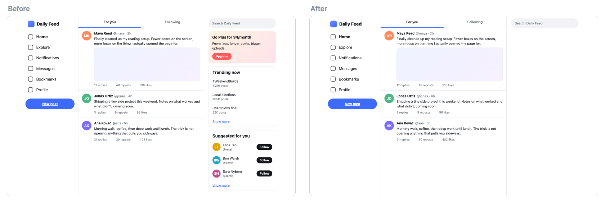

# Hide It

A Chrome extension for hiding parts of websites. Hidden elements stay hidden on every visit and don't show up while the page loads.



## Install

1. Clone this repo.
2. Open `chrome://extensions` and turn on Developer mode.
3. Click Load unpacked and pick the folder.

## Use

- Click the extension icon or press Alt+Shift+H, then point at the page. Scroll to make the selection smaller or bigger, and click to hide it.
- Shift+click keeps the element in place but invisible. It shows up again when you hover over it.
- Hold Alt to see everything you've hidden on the page.
- The popup lists what's hidden on the current site. Hover a row to preview it, or click ✕ to bring it back.
- Copy all rules / Paste rules moves your rules to another Chrome profile.

Rules are stored locally in Chrome. The extension doesn't make any network requests.

## Development

```sh
npm install
npx playwright install chromium
npm test
```

## License

MIT
